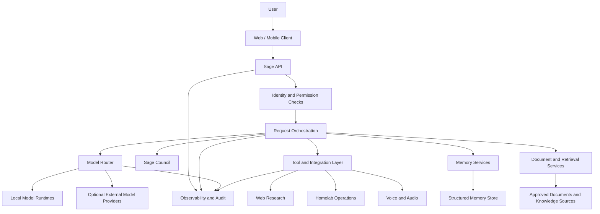

# Sage System Context and Major Layers

**Status:** Target architecture; components are implemented incrementally.

This view shows how a user-facing Sage experience can connect to orchestration, model runtimes, tools, knowledge services, and operations. It is intentionally technology-neutral where implementation decisions are still evolving.

## Design principles

- Keep the client separate from backend orchestration and model runtimes.
- Apply authentication, authorization, and tool-specific permissions before sensitive actions.
- Treat local and external model providers as interchangeable routing targets only when policy permits.
- Keep memory, retrieval, and auditability explicit rather than burying them inside one model prompt.
- Record which components are implemented, experimental, or planned in the relevant project documentation.
