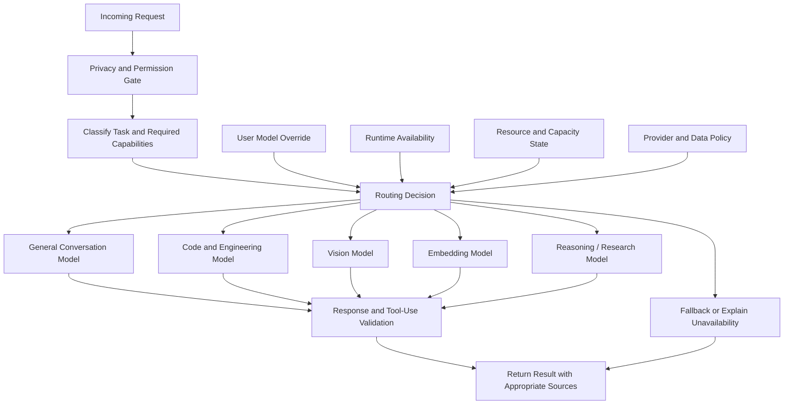

# Automatic Model Routing with Manual Override

**Status:** Target architecture.

Sage is intended to choose a suitable model automatically for each request while allowing the user to override that choice. Routing should consider task capability, runtime availability, resource pressure, latency, privacy policy, and user preference.

## Routing requirements

1. **Manual override:** a user-selected model takes precedence when it is available and permitted.
2. **Capability matching:** route vision, embeddings, coding, and general conversation to runtimes that support the task.
3. **Privacy policy:** do not send restricted content to an external provider unless explicitly allowed by policy and user intent.
4. **Resource awareness:** avoid launching unnecessary models or exhausting shared compute.
5. **Graceful failure:** explain unavailable runtimes and use a permitted fallback only when appropriate.
6. **Traceability:** log the routing decision and relevant non-sensitive reason codes without recording secrets or unnecessary private content.

This diagram describes desired behavior; it does not imply all routing rules or provider integrations are already implemented.
