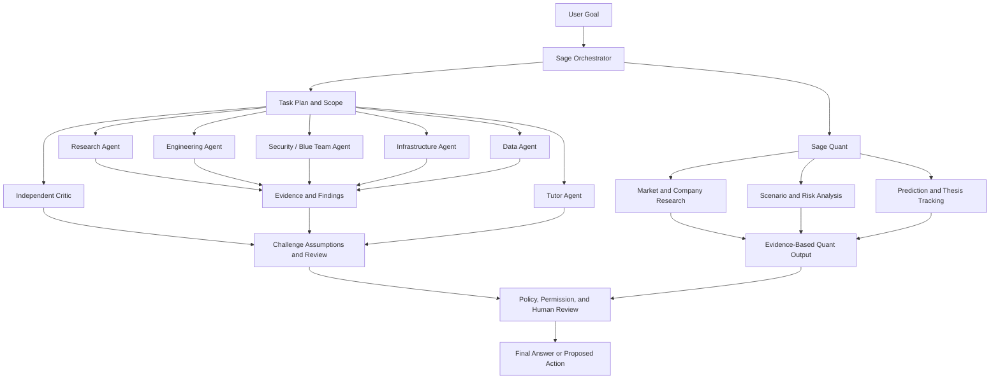

# Sage Council and Sage Quant

**Status:** Target architecture; agent roles and coordination are planned to be implemented in stages.

Sage Council is intended to coordinate specialized agents under a central orchestrator. Sage Quant is a domain-focused capability for financial research and analysis, not an autonomous authority for financial decisions.

## Coordination and safety

- Agents should have scoped roles, independent task context where useful, and limited tool permissions.
- The critic should examine evidence, uncertainty, and conflicting conclusions rather than simply vote with other agents.
- External actions require authorization appropriate to their risk.
- Financial outputs should distinguish sourced facts, assumptions, scenarios, and uncertainty. They should not promise returns or replace the user's judgment.
- Agent count and concurrency should adapt to available compute rather than assume every agent runs simultaneously.
