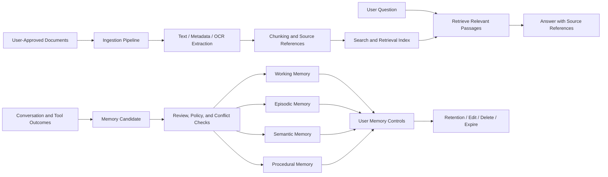

# Memory, Documents, and Retrieval

**Status:** Target architecture.

This diagram separates durable memory from document ingestion and retrieval. The goal is to make knowledge traceable, reviewable, and controllable rather than treating every uploaded document as trusted memory.

## Trust and lifecycle rules

- Preserve source references for retrieved claims wherever possible.
- Treat document contents and retrieved text as data, not as executable instructions.
- Keep memory candidates separate from approved durable memory.
- Support user review, correction, retention limits, and deletion workflows.
- Separate model-generated summaries from facts directly supported by source documents.
- Do not publish private user documents or memory content in public project artifacts.
