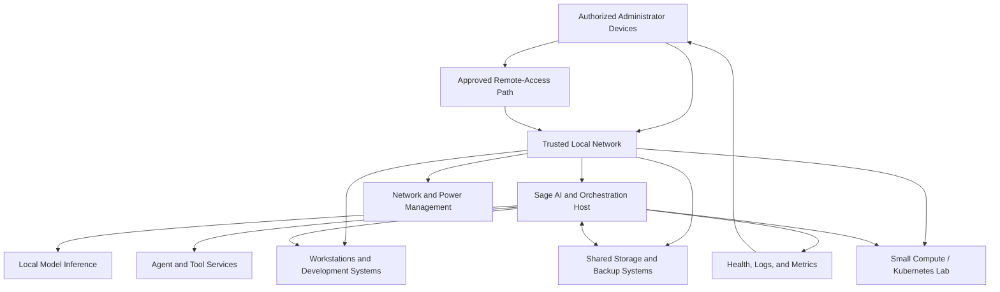

# Homelab Logical Topology

**Status:** Conceptual topology, intentionally sanitized.

This diagram shows the functional roles in Sage's home lab without disclosing the real network layout, addressing, physical hostnames, VPN ranges, management URLs, or storage endpoints.

## Logical roles

- **Sage host:** local AI inference, orchestration, APIs, and selected automation.
- **Workstations:** development, interactive use, and optional on-demand compute.
- **Small compute lab:** Kubernetes and distributed-systems learning.
- **Shared storage:** datasets, documents, model artifacts, and backup destinations.
- **Network and power management:** controlled connectivity and infrastructure operations.
- **Remote access:** an approved, authenticated path for administration; the actual configuration is intentionally not shown.

## Security boundary

This is not a deployment diagram and should not be used to infer reachable services. Public documentation deliberately omits addresses, VLAN IDs, exact device names, ports beyond general concepts, access-control rules, credentials, and storage mount paths. Keep operational runbooks in the private repository and review them for secrets before sharing.
